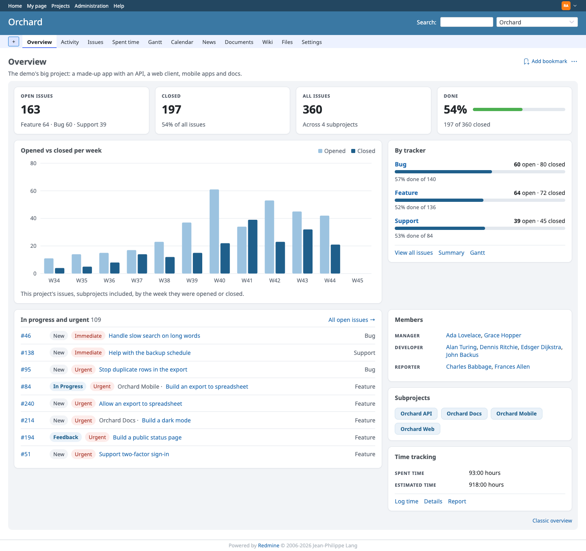
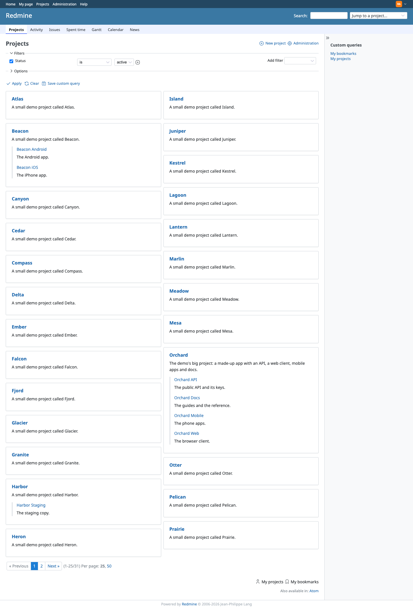
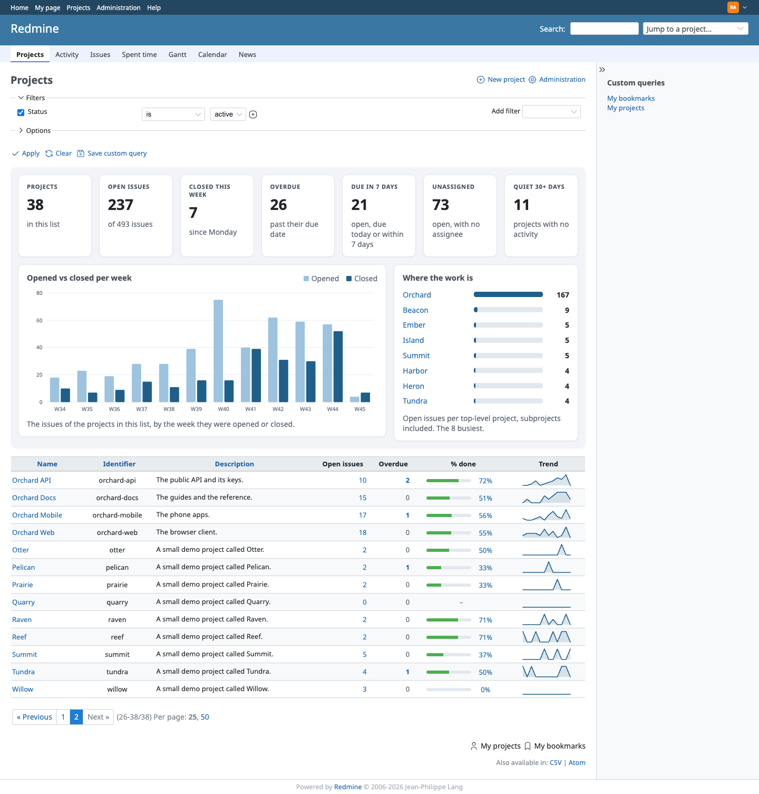
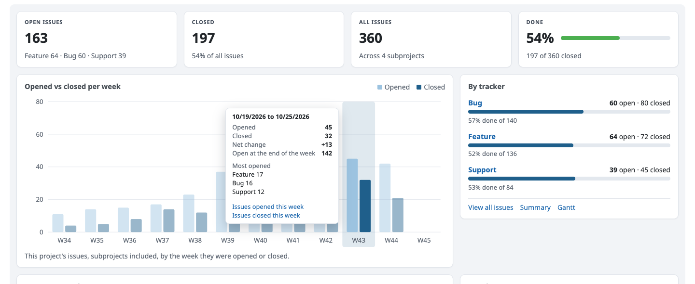
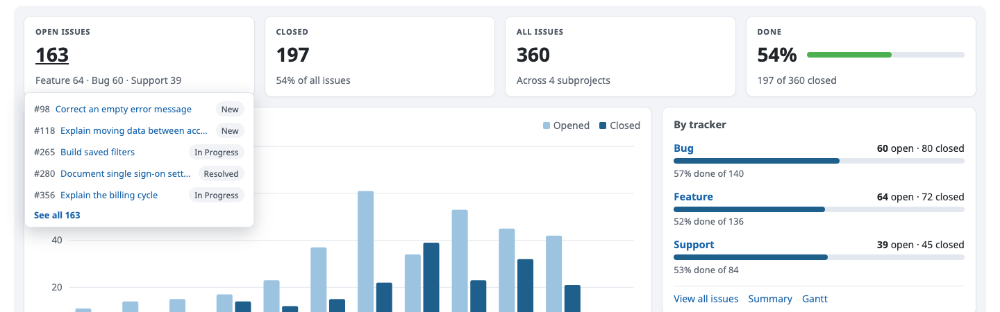
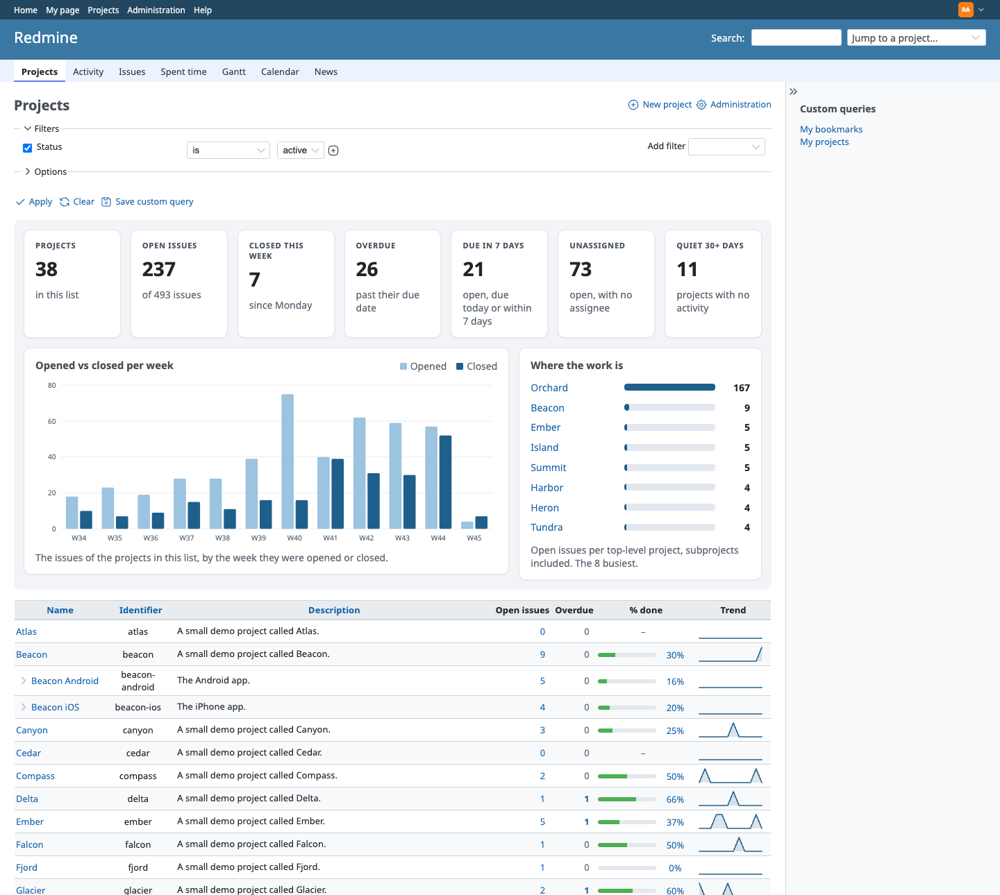
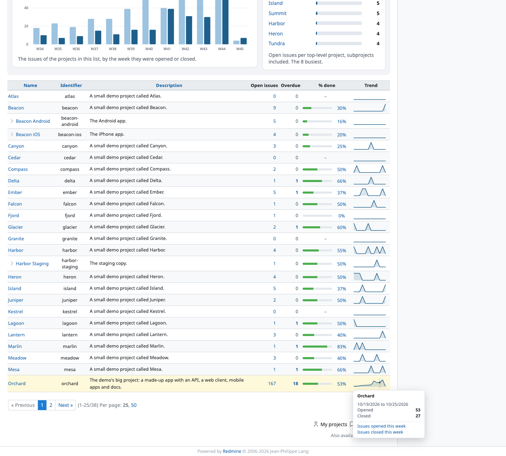
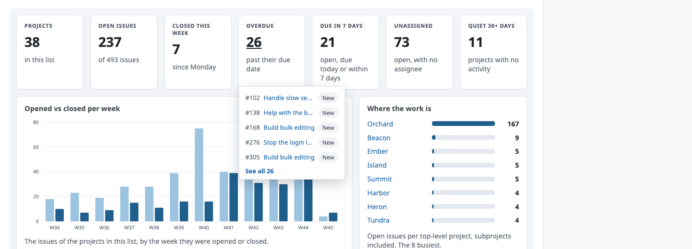
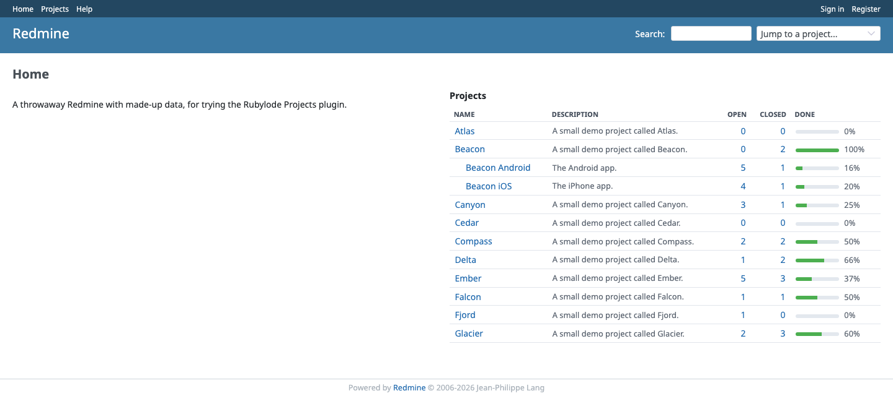
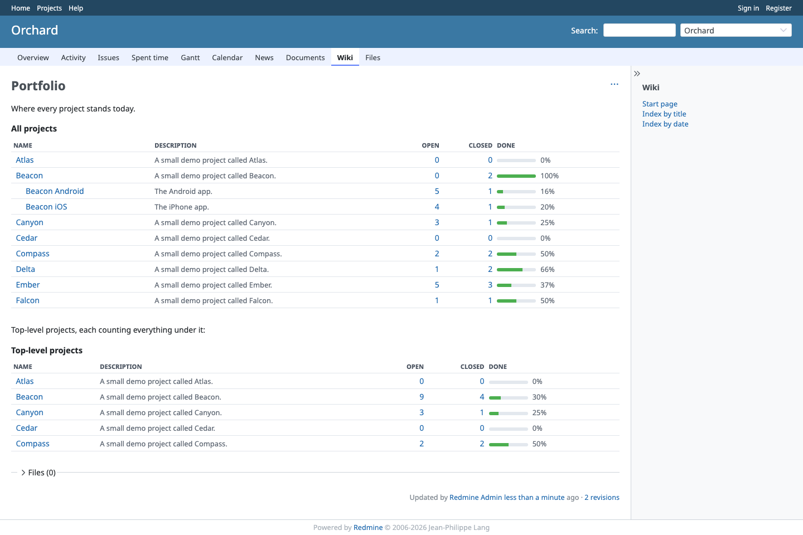

# Rubylode Projects for Redmine

TL;DR: a project Overview page with counts, a weekly chart and a list of urgent issues, plus a summary, extra columns and
paging for the projects list in [Redmine](https://www.redmine.org).

Status: version 1.1.0, Redmine 7 only. `docs/roadmap/ROADMAP.md` lists what is decided and what is open.

Contents:

- [What it does](#what-it-does)
- [Interactivity](#interactivity)
- [The projects list](#the-projects-list)
- [The projects table](#the-projects-table)
- [Settings](#settings)
- [The rules behind the numbers](#the-rules-behind-the-numbers)
- [Compatibility](#compatibility)
- [Installation](#installation)
- [Theming](#theming)
- [Known limits](#known-limits)
- [Try it](#try-it)
- [Tests](#tests)
- [Releasing](#releasing)
- [License](#license)

## What it does

A project's Overview page shows a set of cards in place of Redmine's own blocks:

- The project's description as a one-line subtitle under the title, with the whole of it on hover.
- Four tiles: open issues (split by tracker), closed (as a share of all), all issues (and how many subprojects they span),
  and done (a percentage with a bar). Each count links to the matching issue list, and hovering one shows the issues behind it.
- Opened against closed per week, for the last 12 weeks, as a bar chart drawn on the server (inline SVG). Hover, focus or
  tap a week for its figures; click it for the issues.
- By tracker: one bar per tracker with its open and closed counts and the share done, and links to the issue list, the
  summary and the Gantt chart. Hover a tracker for its open, closed and overdue counts; click it for its list.
- In progress and urgent: up to eight open issues that someone has started or that sit above the default priority, with a
  link to all open issues sorted by priority.
- Members grouped by role, the subprojects as chips, and, when the project tracks time, spent and estimated time with
  links to log time, the details and the report.

The cards replace Redmine's description, issue tracking, time tracking, members and subprojects blocks, so nothing
appears twice. News, custom fields and blocks that other plugins add to the page stay. A "Classic overview" link at the
bottom of the cards (`?view=classic`) shows Redmine's own page with every block, and links back.

Redmine's page is rendered as the installed Redmine has it and passed through untouched inside a wrapper. The stylesheet
hides the replaced blocks under the wrapper's class (`display: none`, so screen readers skip them too).

The projects list at `/projects` opens in the list view with a summary and charts above it (see [The projects list](#the-projects-list)), and gets pages in the board view. Redmine 7 already pages the list view but puts every
project on one page in the board view. The plugin cuts the board into pages with Redmine's own page links and per-page
choice, which reads the "Objects per page options" setting (Administration, Settings, Display). Filters keep working, and
the list view is left as Redmine has it.

## Interactivity

Charts and tiles show what is behind a number without leaving the page.

- The weekly chart. Hover a week, tab to it or tap it (the first tap shows the card, the second follows the link) and a
  card gives the week's dates, issues opened, closed and the net change, how many issues were open at the end of that week,
  and the three trackers most issues were opened in. The week's column is highlighted and the others dim. The card links to
  the issues opened that week and the issues closed that week; clicking the column opens the first list. The legend entries
  are buttons that hide and show a series.
- The tiles. Hover or focus a tile and a card lists the five newest issues behind the number (number, subject, status) with
  a "See all N" link. Clicking the tile goes to that list. The done tile lists the closed issues.

- By tracker. Hover or focus a row for its open, closed and overdue counts and the share done (overdue is open issues past
  their due date). Clicking the row goes to that tracker's issue list.
- Keyboard and screen readers. The weeks are links, so they are in the tab order; the arrow keys move between them and
  Enter opens the list. Escape closes a card. Each week's link carries its figures as its label, and a hidden table repeats
  them with both issue lists for every week (it shows itself when a link in it has focus), so nothing needs the mouse.
  Animations stop under `prefers-reduced-motion`.
- The links are built in one place (`RubylodeProjects::IssueListLink`) in the format Redmine's own filters use
  (`set_filter=1&f[]=created_on&op[created_on]=><&v[created_on][]=...`). Only filter names, whole-number ids and dates go
  into them, all percent-escaped. Subprojects are included or excluded the same way the numbers were counted, with
  Redmine's `subproject_id` filter.
- No extra requests. The figures for all the cards come with the page, in one JSON block, in a fixed number of queries
  however many issues the project has (a test checks that). One small script, `assets/javascripts/overview.js`, plain
  JavaScript with no framework, writes them out as text; without it the page still works, and the weeks and tiles are
  ordinary links.
- Who sees what is the same as everywhere else: the issues in a card go through Redmine's visibility rules.

## The projects list

`/projects` opens in the list view, with a summary above the list and extra columns in it. Redmine's own list is
rendered as the installed Redmine has it; the plugin puts its summary in front and adds columns to Redmine's query.

- Seven tiles: Projects, Open issues, Closed this week, Overdue, Due in 7 days, Unassigned and Quiet 30+ days (projects
  with no activity for 30 days). Each issue tile links to the issue list that holds exactly those issues, and hovering or
  focusing it shows the five newest behind the number.
- Opened vs closed per week over the projects in the list: the same chart, tooltip and keyboard behaviour as a project's
  Overview (one partial and one script serve both).
- Where the work is: open issues per top-level project, the busiest eight, subprojects counted in. Each bar links to
  that project's open issues; hover or focus shows its open, overdue, recently closed and done figures.
- Columns: Open issues, Overdue, Closed (last 7 days), % done (a thin bar) and Trend (a sparkline of issues closed per
  week). They are ProjectQuery columns, so they appear in the list options, and in the CSV export as plain text (the trend
  is the weekly numbers separated by spaces). Last activity is Redmine's own column. Defaults: Redmine's default columns
  (Name, Identifier and Description in a stock install) plus Open issues, Overdue, % done and Trend. A saved query, or a
  visit that names its own columns, keeps exactly those. The new columns cannot be sorted: the figures depend on what the
  viewer may see, so there is no cheap column to sort by.
- Hover a sparkline for the week's opened and closed counts with links to those issues; the arrow keys move between
  weeks, Escape closes the card, and on a touch screen a tap shows it.

What the summary counts. The projects of the list as filtered (every page, not just the one shown), as the viewer may
see them (`Project.visible`, `Issue.visible`). The default filter leaves out closed projects, and archived projects are never
visible; filter the list to show closed projects and they count. Each issue is counted once. A project's own figures include
its subprojects when Redmine's "Display subprojects issues on main projects by default" setting is on, the same as the list
they link to. Weeks run Monday to Sunday in the user's time zone. "Closed this week" is since Monday; the Closed column is
the last seven days. The summary's links filter on the project ids of the list; past 150 projects the links leave that filter
out (the address would be too long) and the page says so, so then a link can list more than its number.

Query count. The summary and the columns add a fixed number of queries however many projects the list holds: grouped
counts, two lists of recent dates, one list of projects and Redmine's own last-activity lookup. A test compares the page
with the plugin on and off for 3 and 30 projects. Redmine's own list adds queries per project, and that does not change.

Back to the board. `/projects?display_type=board` always shows the board. A display named in the address is remembered
for the rest of the session, so the plain Projects link keeps it; a new session starts from the setting. To make the board
the default again, or to follow Redmine's own setting, change "Default projects display" below. `?summary=0` hides the
summary for one request. A saved query (including the default query set in Redmine's settings) is shown as it was saved.

If another plugin adds a summary to the project list. When a plugin that supplies its own summary of the projects list
is installed (this plugin looks for `redmine_projects_dashboard`), it shows neither its tiles and charts nor its columns, so
nothing appears twice; the display choice (list or board) still applies. A different plugin id needs a one-line change in
`RubylodeProjects::Coexistence`.

## The projects table

A table of the projects the viewer may see, each with its open and closed issue counts. It does not replace anything: it is a
block you place. It is not added to `/projects`, which already has the summary and the columns.

- Rows. One per project the viewer may see, in Redmine's project tree order: a project, then its subprojects, indented.
  Archived and closed projects are left out. A subproject whose parent the viewer cannot see is listed as a top-level project.
- Columns. Name (a link), description (one line, cut at 140 characters), Open, Closed and, optionally, a thin done bar.
  Done is the share of closed issues, the same figure as the Overview's done tile.
- Counts. Only issues the viewer may see (`Issue.visible`), grouped by project in two queries however many projects
  there are (a test checks the query count with 3 and 30 projects). Each count links to that project's issue list filtered to
  open or closed, built with `IssueListLink`. A row counts its own issues and its links exclude the subprojects, which have
  rows of their own; with `subprojects=false` only top-level projects get a row, and each counts everything under it, with
  links that include the subprojects.
- Accessible. A real table with a caption, `scope` on every header (the project name is the row header), links that name
  the project and the count for screen readers, a visible focus outline, and a done bar that is decoration next to the
  percentage in text.

### On the welcome page

Turn on "Show the projects table on the welcome page" in the plugin settings. It goes in the left or right column through
Redmine's `view_welcome_index_left` and `view_welcome_index_right` hooks, after the welcome text or the news.

### In a wiki page: the macro

    {{projects_table}}
    {{projects_table(title="Our projects", limit=10, subprojects=false)}}

| Argument | Values | Default |
|---|---|---|
| `title` | the caption (quote it when it holds a comma) | Projects |
| `limit` | a whole number from 1 to 100 | the "Rows in the projects table" setting |
| `subprojects` | `false` for top-level projects only, each counting everything under it; `true` for the tree | true |

An argument the macro does not know, or a limit or subprojects value it cannot use, shows Redmine's macro error. The macro
is meant for wiki pages (including the welcome text), and its description shows in `{{macro_list}}`.

### From another plugin or a theme: the partial

    <%= render partial: "rubylode_projects/projects_table", locals: { title: "Our projects", limit: 10, subprojects: false } %>

The partial is `rubylode_projects/projects_table`. Every local is optional:

| Local | Values | Default |
|---|---|---|
| `title` | the caption | Projects |
| `limit` | 1 to 100 | the settings value |
| `subprojects` | true or false | true |
| `show_description` | true or false | the settings value |
| `show_done_bar` | true or false | the settings value |
| `user` | whose view of projects and issues it is | `User.current` |

It renders nothing when the user may see no project, and it adds the plugin's stylesheet to the page head by itself.

## Settings

Administration, Plugins, Configure. The values are checked when saved: a bad one shows the form again with the problem.

| Setting | Values | Default |
|---|---|---|
| Default projects display | List, Board, Leave to Redmine (Redmine's own "project list display type" setting applies) | List |
| Show the summary and charts above the list | on or off | on |
| Columns added to the project list | any of Open issues, Overdue, Closed (last 7 days), % done, Trend, Last activity | Open issues, Overdue, % done, Trend |
| Weeks in the trend | a whole number from 4 to 26 (the portfolio chart and the sparklines) | 12 |
| Show the projects table on the welcome page | on or off | off |
| Column of the welcome page | Left, Right | Right |
| Rows in the projects table | a whole number from 1 to 100 (also the default for the macro and the partial) | 20 |
| Show the description in the projects table | on or off | on |
| Show the done bar in the projects table | on or off | on |

The default display applies only when the address names no `display_type`, no saved query, and the user has not chosen a
display earlier in the session.

## The rules behind the numbers

- Who sees what. Every count and list goes through Redmine's own issue visibility, so private issues, per-tracker
  permissions and roles that see only their own issues are respected. A project without the Issue tracking module, or a
  user who may not view its issues, gets no issue cards; the members and subprojects cards still show. The time card
  follows Redmine's own rules: it shows to users who may view time entries (which needs the Time tracking module), and
  the totals only to those who may see everyone's time.
- Subprojects. Counts include subprojects when Redmine's "Display subprojects issues on main projects by default"
  setting is on (it is by default), so the numbers match the issue lists they link to. With the setting off, they cover
  the project alone.
- Done is the share of issues that are closed, rounded down, so 100% means every issue is closed. It is not Redmine's
  "% done" field.
- The weekly chart counts an issue as opened in the week of its creation date, and as closed in the week of its closing
  date if it is closed now. Weeks run Monday to Sunday in the user's time zone and are labelled with their ISO week number.
- In progress and urgent. An open issue is listed when either its priority sits above the default priority (High,
  Urgent and Immediate in Redmine's default data), or its status is no longer its tracker's default status, which means work
  has started (In Progress, Feedback and Resolved in the default data). Without a default priority, the middle priority
  stands in for it. The list is sorted by priority, highest first, then by the last update.
- Board pages hold whole trees: the per-page number counts top projects, and each comes with all of its subprojects,
  so a subproject is never on a different page from its parent.

## Compatibility

Redmine 7.x (7.0.0 or newer). I run it on Redmine 7.0.2. The workflow in `.github/workflows/tests.yml` tests 7.0.2 and the 7.0-stable branch on Ruby 3.4 and 4.0. Redmine 6 and older are not supported. The plugin adds no table and no migration.

## Installation

Redmine 7.0 or newer. The folder must be named `redmine_rubylode_projects`, the same as the plugin id.

1. Put the plugin in your Redmine's `plugins` folder:

       cd /path/to/redmine/plugins
       git clone https://github.com/rubylode/redmine-rubylode-projects.git redmine_rubylode_projects

2. Restart Redmine ([Passenger](https://www.phusionpassenger.com), [Puma](https://puma.io) or whatever serves it).
   There is no migration. Settings are under Administration, Plugins, Configure.

3. Open a project's Overview, and Projects.

To remove it, delete the folder and restart. Nothing was changed in the database.

With Redmine in Docker, put the folder in the directory you mount as `/usr/src/redmine/plugins` (or copy it into the
container's `plugins` folder), keep the name `redmine_rubylode_projects`, and restart the container. Without git, unpack
a release archive into `plugins/redmine_rubylode_projects`.

## Theming

The cards use plain CSS (`assets/stylesheets/projects.css`), and every colour and size in it is a `--rubylode-projects-*`
custom property. The plugin sets its defaults in `:where(:root)`, which has no specificity, so a theme wins whenever it
sets a property, on `:root` or on any element, whatever order the stylesheets load in.

Colours:

| Property | Default | Used for |
|---|---|---|
| `--rubylode-projects-page-background` | `#f2f4f7` | the area behind the cards |
| `--rubylode-projects-card-background` | `#ffffff` | the cards |
| `--rubylode-projects-card-border-color` | `#e1e5eb` | card borders and row dividers |
| `--rubylode-projects-card-shadow` | a faint shadow | card shadow (a `box-shadow` value) |
| `--rubylode-projects-text-color` | `inherit` | card text |
| `--rubylode-projects-muted-text-color` | `#5d6672` | notes, issue numbers, axis labels, the subtitle |
| `--rubylode-projects-label-text-color` | `#4a5360` | upper-case labels (tiles, roles, time) |
| `--rubylode-projects-accent-color` | `#1f5f8b` | tracker bars |
| `--rubylode-projects-opened-color` | `#9cc3e0` | "opened" bars and swatch |
| `--rubylode-projects-closed-color` | `#1f5f8b` | "closed" bars and swatch |
| `--rubylode-projects-done-color` | `#4caf50` | the done bar |
| `--rubylode-projects-meter-track-color` | `#e3e8ee` | the empty part of a bar |
| `--rubylode-projects-grid-line-color` | `#e7eaef` | chart grid lines |
| `--rubylode-projects-chip-background` | `#eaf2f9` | subproject chips, "in progress" status chips |
| `--rubylode-projects-chip-border-color` | `#cfe0ee` | subproject chip borders |
| `--rubylode-projects-chip-text-color` | `#1f5f8b` | chip text |
| `--rubylode-projects-waiting-background` | `#f1f3f6` | status chips of issues not started |
| `--rubylode-projects-waiting-text-color` | `#4a5360` | their text |
| `--rubylode-projects-priority-background` | `#fdecea` | priority chips |
| `--rubylode-projects-priority-text-color` | `#a1281c` | their text |

Sizes:

| Property | Default | Used for |
|---|---|---|
| `--rubylode-projects-gap` | `14px` | space between and around cards |
| `--rubylode-projects-card-padding` | `14px 16px` | inside a card |
| `--rubylode-projects-card-radius` | `10px` | card and card-area corners |
| `--rubylode-projects-chip-radius` | `8px` | subproject chip corners |
| `--rubylode-projects-tile-minimum-width` | `170px` | narrowest tile before the tiles wrap |
| `--rubylode-projects-meter-height` | `8px` | thickness of the bars |
| `--rubylode-projects-swatch-size` | `10px` | legend swatches |
| `--rubylode-projects-member-label-width` | `8em` | the role column |
| `--rubylode-projects-time-label-width` | `12em` | the label column of the time card |
| `--rubylode-projects-heading-size` | `1.05em` | card headings, tracker names |
| `--rubylode-projects-tile-value-size` | `2em` | the big numbers |
| `--rubylode-projects-label-size` | `0.8em` | upper-case labels |
| `--rubylode-projects-small-text-size` | `0.92em` | notes, chips, the classic-overview link |
| `--rubylode-projects-subtitle-size` | `1em` | the subtitle |
| `--rubylode-projects-axis-label-size` | `11px` | chart axis labels |
| `--rubylode-projects-space-small` | `0.35em` | small spacing |
| `--rubylode-projects-space-medium` | `0.6em` | medium spacing |
| `--rubylode-projects-space-large` | `1em` | large spacing |

Tooltips, popovers and the week highlight:

| Property | Default | Used for |
|---|---|---|
| `--rubylode-projects-tooltip-background` | the card background | the cards that appear on hover |
| `--rubylode-projects-tooltip-text-color` | the text colour | their text |
| `--rubylode-projects-tooltip-border-color` | the card border colour | their border and dividers |
| `--rubylode-projects-tooltip-shadow` | `0 8px 24px rgba(16, 24, 40, 0.22)` | their shadow |
| `--rubylode-projects-highlight-color` | 14% of the accent colour | the column behind the week being looked at |
| `--rubylode-projects-dim-opacity` | `0.45` | the bars of the other weeks while one is looked at |
| `--rubylode-projects-tooltip-minimum-width` | `15em` | narrowest tooltip |
| `--rubylode-projects-tooltip-maximum-width` | `26em` | widest tooltip |

The projects list adds these (dark mode follows the theme: each one defaults to a property above, so a theme that restyles
the cards restyles these):

| Property | Default | Used for |
|---|---|---|
| `--rubylode-projects-summary-tile-minimum-width` | `130px` | narrowest summary tile |
| `--rubylode-projects-overdue-color` | `#c0392b` | a non-zero Overdue count |
| `--rubylode-projects-progress-width` | `6.5em` | the % done bar's length |
| `--rubylode-projects-progress-height` | `6px` | its thickness |
| `--rubylode-projects-progress-track-color` | the meter track colour | the empty part of the % done bar |
| `--rubylode-projects-progress-fill-color` | the done colour | its filled part |
| `--rubylode-projects-bar-fill-color` | the accent colour | the bars of "Where the work is" |
| `--rubylode-projects-bar-track-color` | the meter track colour | their empty part |
| `--rubylode-projects-bar-height` | `10px` | their thickness |
| `--rubylode-projects-bar-name-width` | `9em` | the project name column of the bars |
| `--rubylode-projects-sparkline-width` | `96px` | the Trend sparkline's width |
| `--rubylode-projects-sparkline-height` | `26px` | its height |
| `--rubylode-projects-sparkline-line-color` | the closed colour | its line and dot |
| `--rubylode-projects-sparkline-area-color` | 16% of the closed colour | the area under it |
| `--rubylode-projects-sparkline-marker-color` | the muted text colour | the marker on the hovered week |

The tooltip colours default to the card colours and the highlight to a tint of the accent colour, so a dark theme that
restyles the cards restyles the tooltips and the highlight with them.

The projects table adds these (each defaults to a property above, so a dark theme that restyles the cards restyles the table):

| Property | Default | Used for |
|---|---|---|
| `--rubylode-projects-table-border-color` | the card border colour | row dividers |
| `--rubylode-projects-table-header-text-color` | the label text colour | column headings |
| `--rubylode-projects-table-row-hover-background` | the highlight colour | the row under the pointer |
| `--rubylode-projects-table-indent` | `1.25em` | indent per subproject level |
| `--rubylode-projects-table-description-width` | `24em` | widest the description column grows |
| `--rubylode-projects-table-bar-width` | `5em` | the done bar's length |
| `--rubylode-projects-table-bar-height` | `6px` | its thickness |
| `--rubylode-projects-table-bar-track-color` | the meter track colour | its empty part |
| `--rubylode-projects-table-bar-fill-color` | the done colour | its filled part |
| `--rubylode-projects-table-focus-color` | the accent colour | the keyboard focus outline |

A block to paste into a theme and adjust (soft grey page, white cards, a blue ramp from light to dark):

    :root {
      --rubylode-projects-page-background: #f4f5f7;
      --rubylode-projects-card-background: #ffffff;
      --rubylode-projects-card-border-color: #e3e6ea;
      --rubylode-projects-muted-text-color: #5b6470;
      --rubylode-projects-opened-color: #a9c8ec;       /* blue 200 */
      --rubylode-projects-accent-color: #2f6fc0;       /* blue 600 */
      --rubylode-projects-closed-color: #1d4f91;       /* blue 800 */
      --rubylode-projects-chip-background: #e8f1fb;    /* blue 50 */
      --rubylode-projects-chip-border-color: #c9ddf4;  /* blue 100 */
      --rubylode-projects-chip-text-color: #1d4f91;    /* blue 800 */
      --rubylode-projects-card-radius: 12px;
    }

## Known limits

- Redmine 7 only; older versions are not supported.
- The cards replace Redmine's overview blocks by hiding them with CSS. A theme or plugin that restyles those blocks'
  classes may show or hide them differently; `?view=classic` always shows Redmine's own page.
- The Overview's weekly chart covers 12 weeks and its in-progress list at most eight issues; the projects list's trend weeks are a setting.
- The Open, Overdue, Closed, % done and Trend columns cannot be sorted.
- Board pages hold whole project trees, so a page can be longer than the per-page number when a top project has many
  subprojects.
- Only English text ships. Labels are in `config/locales/en.yml`, so another language is a locale file away.

## Try it

A throwaway Redmine 7 runs from this folder, with the repository mounted as the plugin:

    ruby bin/demo up        start it on http://localhost:3009 and load the demo data
    ruby bin/demo restart   pick up a change to the plugin
    ruby bin/demo reset     wipe it

The demo data (`test/seed.rb`) is made up: 38 projects, one big project called Orchard with 360 issues over 14 weeks, due dates on some open issues, a few issues closed this week and eight people. Sign in as admin / admin, or as `ada.lovelace` (and the others) with `demo-password-1`.

## Tests

    bin/test                                                   all unit and integration tests
    bin/test test/integration/project_overview_page_test.rb    one file

They run in a Redmine 7 image with its test gems (`docker/test.Dockerfile`). The numbers (percentages, weekly buckets,
the chart scale and layout, the urgency rule, the board pages, the issue list links, the weekly running totals) are plain
Ruby classes with their own unit tests. Integration tests (`test/integration/overview_interactivity_test.rb`, `projects_summary_test.rb`, `project_columns_test.rb`, `default_display_test.rb`) check the tooltip data, the markup and the query count. I checked the script by hand in Chrome (hover, focus, tap, Escape, click through to a filtered list). That check is not in the repository.

Pull Requests are welcome!

## Releasing

Push a `vX.Y.Z` tag whose version matches `version` in `init.rb` and that has an entry in `CHANGELOG.md`. The release
workflow runs the tests on every supported Redmine and Ruby, builds `redmine_rubylode_projects-X.Y.Z.zip` (with a checksum
file) and publishes the GitHub release with that changelog entry as its notes. To build a release for a tag that already
exists, open Actions, choose release, Run workflow, and enter the tag.

The text for the www.redmine.org listing, and how to read the result of Check for updates, is in [docs/redmine-org-listing.md](docs/redmine-org-listing.md).

## License

GNU General Public License, version 2 or (at your option) any later version, the same as Redmine. See `LICENSE`.

Copyright (C) 2026  Nick Gorbikoff

No warranty, as the GPL says. The plugin changes how two of Redmine's pages are drawn, so try it on a copy of your tracker before the real one.
